# Hi there, I'm Shaurya 👋

## About me 🧑‍💻:
I'm a Year 8 student at Wallington County Grammar School 🏫 with a growing interest in Computer Science and coding 💻. I'm hoping to take it through GCSE and A-Level 🎓, and I'm even considering it as a career 💼. Right now, I'm using the GitHub Student Developer Pack to learn Python 🐍 and build a deeper understanding of how computers and code 💻 actually work ⚙️. My favourite quote is: “Code is read much more often than it is written.” – Guido Van Rossum, creator of Python.

## Goals by the end of Year 8 🎯:
- Build my first proper Python 🐍 project from scratch
- Get comfortable with the basics: variables, loops, functions, and beyond
- Explore where Computer Science could take me — GCSE, A-Level 🎓, and possibly further
- Keep building on GitHub as I learn, one commit at a time

## 🌐 My Websites
- **[shauryakshitij.com](https://shauryakshitij.com)**: My personal site, all about me and my blog
- **[Shaurya's Hub](https://shauryashub.dev/visit?ref=github)**: My own web hub, a project I built and run myself

## 📫 How to Reach Me
- 📧 Email: 25skshi@wcgschool.co.uk
- Or feel free to open an issue on one of my repos here on GitHub

### Feel free to check back — this profile will grow as I do.

  

<!--
**BossKingCoder/BossKingCoder** is a ✨ _special_ ✨ repository because its `README.md` (this file) appears on your GitHub profile.

Here are some ideas to get you started:

- 🔭 I’m currently working on ...
- 🌱 I’m currently learning ...
- 👯 I’m looking to collaborate on ...
- 🤔 I’m looking for help with ...
- 💬 Ask me about ...
- 📫 How to reach me: ...
- 😄 Pronouns: ...
- ⚡ Fun fact: ...
-->
